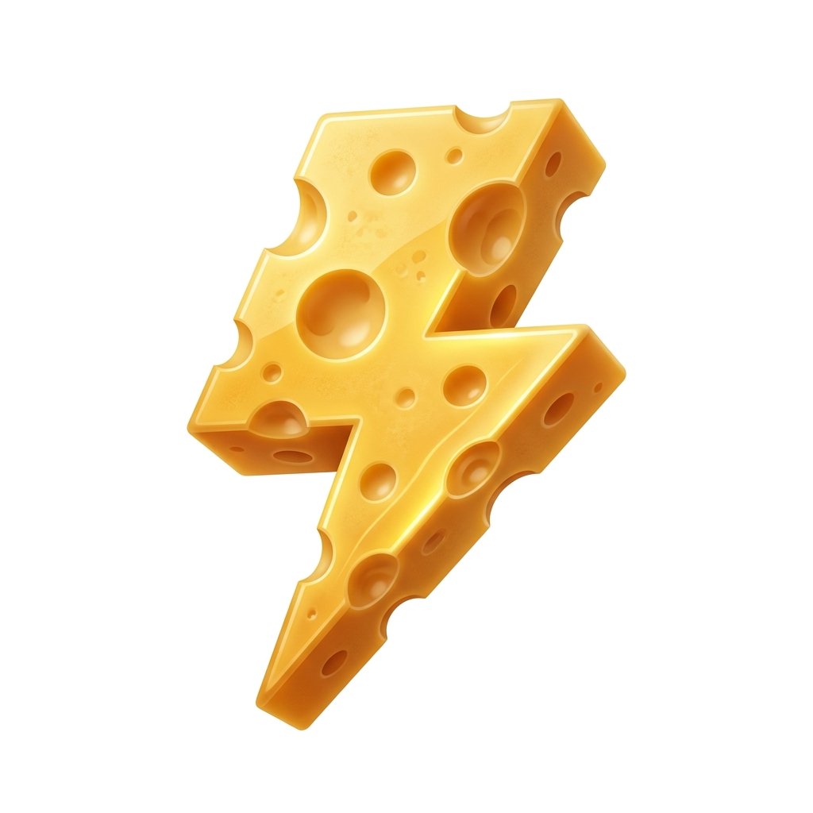

  

# ⚡ 치트 플래시 (Cheat Flash) v1.0.0 릴리즈 노트

2000년대 추억의 플래시 게임을 고해상도 환경에서 쾌적하게 즐기고, 자유롭게 속도를 조절하며 원하는 수치를 손쉽게 편집할 수 있는 **치트 플래시 (Cheat Flash) v1.0.0** 정식 릴리즈입니다.

---

## 🌟 주요 기능 및 변경 사항 (Key Highlights)

### 1. 🎯 스마트 델타 헌터 (실시간 변동 감지 & 99.9% 소거 마법사)
- **수치 변동 감지 기반 초간편 적중**:
  - 현재 수치(예: 100)를 입력하고 `[🎯 추적 시작]`을 누른 후, 게임에서 수치가 변하는 즉시 해당 메모리 주소를 자동 포착하여 최상단에 하이라이트 표시합니다.
  - 변경 후 수치(예: 85)를 입력하고 `[🔍 99.9% 소거]`를 누르면 수천 개의 무관한 메모리를 단번에 제거하고 단 1개의 핵심 주소만 남깁니다.
  - 포착된 메모리에 **[999,999 주입]** 및 **[무한 고정]**을 원클릭으로 적용할 수 있습니다.
- **400px+ 대화면 결과창**: 세로 높이를 400px 이상 대폭 확장하여 스크롤 없이 수많은 메모리 변동을 편안하게 감시할 수 있습니다.
- **원클릭 서브 세그먼트 전환**: `[🎯 간편 델타 헌터 (추천)]`와 `[⚙️ 클래식 정밀 스캐너]`를 상단 탭으로 손쉽게 전환할 수 있습니다.

### 2. 📋 치트 메모리 조작 북 & 파일 입출력 (Tab 2)
- **게임별 자동 기록 누적**: 메모리 검색기에서 편집된 모든 수치가 최신순으로 자동 등록되어 보존됩니다.
- **수치 수정 & 무한 고정(Freeze)**: 실시간 수치 인라인 수정 및 백그라운드 영구 고정을 지원합니다.
- **치트 프리셋 파일 저장/불러오기 (.json)**: 찾은 치트 메모리 목록을 JSON 파일로 저장(`[💾 내보내기]`)하거나 공유된 치트 프리셋을 언제든 가져오기(`[📂 불러오기]`)할 수 있습니다.

### 3. 🎮 다중 게임 세션 슬롯 (3 Multi-Game Slots)
- 상단 **`[🎮 슬롯 1]` `[🎮 슬롯 2]` `[🎮 슬롯 3]`** 탭으로 여러 플래시 게임을 동시에 관리할 수 있습니다.
- 슬롯 전환 시 게임별 실행 상태, 시간 배속 및 치트 테이블이 완벽하게 독립 보존됩니다.

### 4. 📦 100% 오프라인 Ruffle WASM 에뮬레이터 내장
- 공식 Ruffle WASM 바이너리를 로컬 `ruffle/` 디렉터리에 사전 번들링하여, 인터넷이 연결되지 않은 오프라인 환경에서도 지연 없이 즉시 플래시를 실행할 수 있습니다.

### 5. ⏱️ 만능 시간 왜곡 (Speedhack Engine)
- **0.1x ~ 10.0x 자유로운 속도 조절**: 슬로우모션 정밀 회피부터 고속 파밍까지 실시간 슬라이더 및 단축키로 제어합니다.
- **0% CPU 완전 일시정지 (F1)**: 게임 렌더링과 물리 연산을 완전히 멈추어 CPU 부하를 0%로 절감합니다.
- **1프레임 미세 전진 (F4)**: 정확히 1프레임(+16.6ms)만 물리 연산을 진행하고 즉시 재동결하여 정밀한 프레임 단위 조작이 가능합니다.
- **Web Audio 사운드 싱크**: 배속에 맞춰 BGM과 효과음 속도가 자동 연동되며, 일시정지 시 소리 지연이나 잡음 없이 즉시 멈춥니다.

### 6. 🛡️ 플래시 안티치트 자동 무력화
- SWF 파일 로드 시 `confereNDS` 등 유명 플래시 안티치트 검증 함수를 자동 감지하여 바이트코드 패치를 적용합니다.

### 7. 🗗 독립 윈도우 인스펙터 분리 (Undock & Multi-Monitor)
- 우측 치트 인스펙터 패널을 독립된 일반 윈도우 폼으로 분리하여 다른 모니터로 자유롭게 이동할 수 있습니다.
- 창 위치 및 크기 자동 기억, 메인 화면으로의 원클릭 재도킹을 완벽 지원합니다.

### 8. 🖱️ 정통 플래시 우클릭 메뉴 & 조작 안전망
- 플래시 화면 우클릭 시 확대, 축소, 100%, 퀄리티 제어 등 정통 플래시 메뉴를 지원합니다.
- 우클릭을 막아둔 게임에서도 메뉴가 항상 호출되도록 캡처 안전망을 탑재했습니다.
- 게임 고유의 **스페이스바, 엔터, 방향키** 입력을 100% 보존하여 조작 충돌을 원천 차단했습니다.

### 9. 🧀 치트오매틱 오마주 치즈 번개 브랜드 아이콘
- 90년대/2000년대 치트오매틱의 클래식 조각 구멍 치즈를 역동적인 번개 실루엣으로 재해석한 고해상도 3D 브랜드 아이콘(`icon.png`, `icon.ico`, `favicon.ico`)이 적용되었습니다.

---

## ⌨️ 단축키 안내

| 키 | 기능 | 설명 |
| :--- | :--- | :--- |
| **F1** | ⏸ **일시정지 / 게임 재개** | 게임 연산을 멈추고 CPU 부하 0%로 동결 |
| **F2** | ⏪ **슬로우모션 (0.5x)** | 정밀한 탄막 회피나 타이밍 공략용 반속 모드 |
| **F3** | ⏩ **초고속 재생 (2.0x)** | 지루한 대기 시간이나 노가다 구간 돌파용 2배속 |
| **F4** | ⏭ **1프레임 미세 전진 (+16.6ms)** | 1프레임 단위로 미세 조작 및 전진 |
| **F5 / 0** | ⚡ **정상 배속 복귀 (1.0x)** | 본래 게임 기본 속도로 즉시 복귀 |
| **[ / ]** | ⏳ **0.25x 미세 배속 조절** | 원하는 속도로 정밀 조절 |
| **우클릭** | 🖱️ **플래시 메뉴 열기** | 확대/축소/100%/퀄리티 설정/툴바 접기 |

---

## 📦 배포 아티팩트 안내 (Distribution Assets)

- **소스 코드 저장소**: [GitHub - L-Jack-00/CheatFlash](https://github.com/L-Jack-00/CheatFlash)
- **무설치 포터블 패키지**: `CheatFlash-v1.0.0-Portable.zip` (72.6 KB)
  - Python 3.10+ 환경에서 `python run.py` 명령 하나로 즉시 실행 가능합니다.
